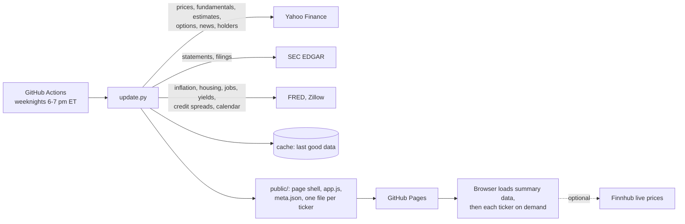

# Terminal Lite

A Bloomberg-style market terminal for the S&P 500, built on free public data and rebuilt automatically every weeknight.

**Live site: https://rrana23.github.io/terminal-lite/**

<!-- Screenshots go here once the design is final: docs/markets.png, company.png, options.png, economy.png, guide.png -->

## What it does

Type a ticker and a function into the command bar, the way you would on a Bloomberg terminal: `NVDA FA`, `SPY OMON`, `ECO`. Press `/` to jump to the bar, `1`-`9` to switch tabs, `?` for the command list.

| Bloomberg function | Terminal Lite | What you get |
|---|---|---|
| GP | `NVDA` | Candlestick chart up to 10 years, indicators, and 1, 5, 10, 20, 50, 100 and 200-day moving averages plus any custom period (`NVDA MA`) |
| DES | `NVDA DES` | Company profile, sector, headcount, headline financials |
| FA | `NVDA FA` | 5 years of income statement, cash flow and balance sheet, copy to Excel |
| DCF / WACC | `NVDA DCF`, `NVDA WACC` | Five-year DCF seeded from the statements, CAPM cost of equity with adjusted beta, WACC, terminal value, sensitivity grid |
| EE | `NVDA EST` | EPS estimate trend and revisions, consensus EPS and revenue, price targets, biggest estimate changes |
| ANR | `NVDA ANR` | Analyst rating score out of 10, one-year history of every upgrade and downgrade, each firm's latest opinion and target |
| Leverage / CRPR | `NVDA LEV` | Net debt/EBITDA, interest coverage, synthetic rating, Altman Z, liquidity, five years of debt and cash, peers |
| DVD / ERN | `NVDA DVD` | Dividends & Earnings: yield and payout vs the market, dividend growth, payment dates, EPS estimate vs actual with beats and misses, earnings metrics vs industry, dividend history and leaders |
| CF | `NVDA CF` | SEC filings with links |
| HDS | `NVDA HDS` | Institutional and mutual fund holders |
| Insider screens | `NVDA INS` | Recent insider trades |
| RV | `NVDA RV` | Industry comps, implied value at peer median, possible acquirers |
| EQS | `EQS` | S&P 500 screener and factor scores |
| OMON / OSA | `SPY OMON` | Options chains for 71 names, IV smile and term structure, max pain, strategy payoff builder |
| NFP / ECST | `JOBS` | Payrolls by month and sector, U-3 and U-6 unemployment, participation, wages vs inflation, jobless claims, openings, Sahm rule |
| GDP / ECST | `GDP` | Real GDP growth every quarter since 1947 with recessions shaded, contributions by component, GDPNow, consumer spending, saving rate, retail sales |
| CPI | `CPI` | Headline and core CPI and PCE, shelter, food, energy, 3- and 6-month annualized rates, Fed target; every economy chart shows date and value on hover |
| GC | `GC` | Treasury yield curve vs 1 month, 1 year and 5 years ago; yield, curve and credit spread history; inversion signals |
| YAS | `YAS` | Bond calculator: price, duration, convexity, DV01, spread to Treasuries, price-yield chart |
| TOP / CN | `TOP`, `NVDA CN` | Market and company headlines |
| EVTS / ECO / DVD | `EVTS`, `ECO`, `DVD` | Earnings, economic and ex-dividend calendars, Fed meetings, key indicators |
| PORT | `PORT` | Portfolio value, P&L, risk (volatility, VaR, drawdown), allocation, stress tests |
| | `NVDA AMD AVGO` | Grouping: compare up to 10 tickers with the VIX and the scenarios they are most exposed to |

Also: an About tab explaining how it's built (`ABOUT`), housing and inflation (FRED, Zillow), desks for nine finance roles, optional live prices (Finnhub), dark and light themes, phone layout, and install-as-an-app.

## How it works

- **Nightly pipeline.** A scheduled GitHub Action runs `update.py`, which downloads the data, checks each source looks complete, and builds the site. If a source fails, the last good copy (kept in the Actions cache) is used, so the site never breaks.
- **Loads fast.** The page starts with a ~400 KB summary; each ticker's 10-year history, filings or option chain loads only when you open it.
- **Add-on design.** Each feature lives in `extras/`: a `.py` file that fetches its data and a `.js` file that adds its screens. New features don't touch the core.
- **Fallbacks.** When SEC EDGAR blocks the build server, statements and filings come from Yahoo Finance instead.

## Repository

| Path | Purpose |
|---|---|
| `template.html` | Core page and app code |
| `update.py` | Fetches data and builds `public/` |
| `extras/` | Add-ons: fundamentals, company pages, news and events, options, rates, jobs, growth and inflation, DCF, estimates, credit and dividends, ratings, moving averages, live prices, design, command bar, guide, about, tab order |
| `.github/workflows/update.yml` | Schedule, cache and deploy |
| `sp500.json`, `extra.json`, `housing.json` | Seed data, used only if a first fetch fails |

Run locally: `pip install yfinance pandas numpy requests lxml`, then `FRED_API_KEY=yourkey python update.py`, then `python -m http.server -d public`.

## Data and limits

Prices and fundamentals are end-of-day from Yahoo Finance (via the unofficial `yfinance` library); statements from SEC EDGAR or Yahoo; macro from FRED, Zillow and Realtor.com; Fed dates from federalreserve.gov. Free data has gaps and errors, so treat figures as approximate. Live prices need your own free Finnhub key, stored only in your browser. Personal, educational project. Not investment advice.

Built by Ryan ([@RRana23](https://github.com/RRana23)) with AI assistance (Claude).
